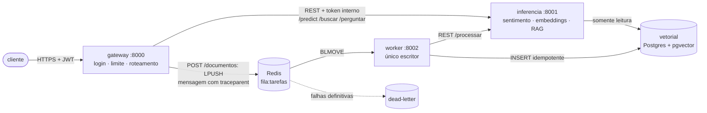
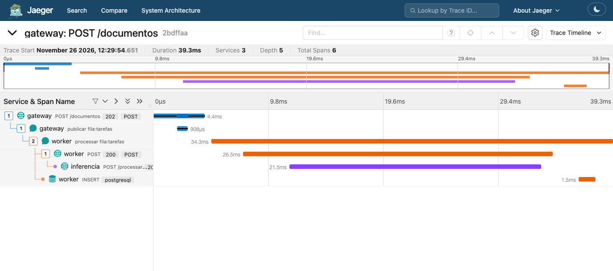
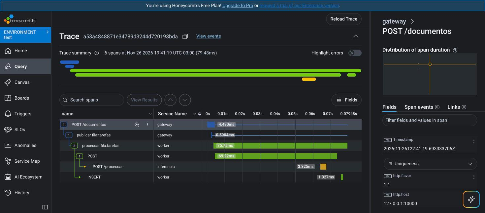

# C3.A2 — Plataforma de IA como Serviço

Projeto integrador de **Sistemas Distribuídos e Computação em Nuvem** · FAESA · 2026/2
Autor: Felipe Umpierre (trabalho individual)

Plataforma em microsserviços que classifica sentimento, indexa documentos por fila e responde
perguntas com base neles (RAG), com JWT, limite de requisições, resiliência, rastreamento
distribuído, `docker compose` e deploy gratuito.

## No ar

**<https://c3a2-gateway-vlib.onrender.com>**

- **Abra essa URL no navegador antes de usar.** No plano gratuito os serviços dormem após 15
  minutos sem tráfego. A página inicial acorda a inferência e o worker e, em 45 segundos, leva à
  documentação interativa. Espere os dois quadros mostrarem `"status":"ok"`.
- **Sem navegador** (por exemplo, só com `curl`), acorde os três e espere cada um responder
  (cerca de 30 segundos):

  ```bash
  curl https://c3a2-gateway-vlib.onrender.com/saude
  curl https://c3a2-inferencia-iwrc.onrender.com/saude
  curl https://c3a2-worker.onrender.com/saude
  ```

- **Se vier `503`** depois de uma pausa, repita o passo acima. Um serviço adormecido não acordou
  com as chamadas do próprio gateway, só com acesso externo
  ([detalhes](docs/trade-offs.md#publicado)).
- **Credenciais:** o usuário e a senha do ambiente publicado são enviados ao professor por
  e-mail e não ficam no repositório.
- O banco gratuito expira 30 dias depois da criação (criado em 26/11/2026). Depois disso, a
  indexação e a busca param no ambiente publicado; localmente nada muda.

## Arquitetura



| Serviço | Responsabilidade | Local | Nuvem |
|---------|------------------|-------|-------|
| [gateway](gateway/) | porta de entrada única: JWT, limite de requisições, roteamento e fila | compose | Render web service |
| [inferencia](inferencia/) | modelo de sentimento, embeddings, busca e geração (LLM simulado) | compose | Render web service |
| [worker](worker/) | consome a fila, pede o processamento à inferência e grava | compose | Render web service (consumidor em *thread*) |
| [vetorial](vetorial/) | armazenamento vetorial (Postgres 17 + pgvector) | compose | Render Postgres |
| fila | Redis: fila de tarefas, estado e limite de requisições | `redis:7-alpine` | Render Key Value |
| traces | OpenTelemetry | Jaeger | Honeycomb |

[comum](comum/) guarda o que os serviços compartilham (contrato da fila, validação, log,
resiliência e rastreamento). Um serviço nunca importa código de outro.

### Decisões principais

- **O modelo existe num lugar só.** O worker não carrega IA: chama a inferência e grava.
- **Um escritor e um leitor** no banco. A consistência é eventual: o documento aparece na busca
  depois de processado.
- **Embeddings de dimensão fixa** (`HashingVectorizer`, 512): serviços independentes geram
  vetores compatíveis sem compartilhar vocabulário.
- **Idempotência:** o id do documento é `sha256(origem + texto)`; reenviar não duplica.
- **Zero Trust entre serviços:** na nuvem, inferência e worker têm URL pública (o plano gratuito
  não recebe tráfego privado), por isso exigem um token interno em tudo, menos em `/saude`.

O raciocínio completo está no [diário de implementação](docs/implementacao.md).

## Como executar do zero

Precisa de **Docker com Compose v2** e de internet apenas no primeiro *build*. Não precisa de
`.env`, chave de API nem Python.

```bash
git clone https://github.com/feumpi/sd-2026-2-kit-c3a2.git
cd sd-2026-2-kit-c3a2
docker compose up --build
```

Quando os serviços ficarem saudáveis:

| Endereço | O que é |
|----------|---------|
| <http://localhost:8000> | API (documentação interativa em `/docs`) |
| <http://localhost:16686> | Jaeger, com os traces |

Só essas duas portas são publicadas; as demais ficam na rede do compose. Para encerrar:
`docker compose down` (com `-v` apaga também os dados).

## Usando a API

As credenciais abaixo valem **somente no compose local**: usuário `aluno`, senha
`senha-local-do-compose`. Os exemplos usam [`jq`](https://jqlang.org) para ler o token.

```bash
API=http://localhost:8000

TOKEN=$(curl -s $API/login -H 'Content-Type: application/json' \
  -d '{"usuario":"aluno","senha":"senha-local-do-compose"}' | jq -r .token)
AUTH="Authorization: Bearer $TOKEN"

# síncrono: sentimento
curl -s $API/predict -H "$AUTH" -H 'Content-Type: application/json' \
  -d '{"texto":"o atendimento foi excelente"}'

# assíncrono: devolve 202 e o caminho para acompanhar a tarefa
TAREFA=$(curl -s $API/documentos -H "$AUTH" -H 'Content-Type: application/json' \
  -d '{"texto":"O algoritmo do valentão elege o processo de maior identificador","origem":"aula-eleicao"}' \
  | jq -r .acompanhar)
sleep 2
curl -s $API$TAREFA -H "$AUTH"

# busca vetorial e pergunta respondida com base nos documentos
curl -s $API/buscar -H "$AUTH" -H 'Content-Type: application/json' \
  -d '{"pergunta":"como o algoritmo do valentão elege","top_k":3}'
curl -s $API/perguntar -H "$AUTH" -H 'Content-Type: application/json' \
  -d '{"pergunta":"qual processo o algoritmo do valentão elege?"}'
```

Na documentação interativa, faça o `POST /login`, copie o `token` e use o botão **Authorize**.

### Rotas

| Rota | Token | Comportamento |
|------|-------|---------------|
| `GET /` | não | vai para `/docs`; na nuvem, antes mostra a página que acorda os serviços |
| `GET /saude` | não | responde sem depender dos outros serviços; mostra o disjuntor |
| `POST /login` | não | `{usuario, senha}` → JWT com validade (60 min) |
| `POST /predict` | sim | `{texto}` → sentimento e confiança |
| `POST /documentos` | sim | `{texto, origem}` → **202** com o id da tarefa |
| `GET /tarefas/{id}` | sim | `pendente`, `concluida` ou `falhou`; **404** se não existe ou expirou |
| `POST /buscar` | sim | `{pergunta, top_k}` → documentos mais parecidos |
| `POST /perguntar` | sim | `{pergunta, top_k}` → resposta fundamentada e fontes |

Erros: `401` sem token válido, `422` entrada inválida, `429` acima de 60 requisições por minuto
e `503` quando uma dependência está fora (ambos com `Retry-After`).

## Resiliência

| Mecanismo | Onde | Como se comporta |
|-----------|------|------------------|
| Tempo-limite | toda chamada HTTP, Redis, Postgres e LLM | nenhuma espera sem fim; a soma das tentativas também tem teto |
| Retentativa | gateway → inferência, worker → inferência, inferência → LLM | espera progressiva com *jitter*, só para falha transitória em operação idempotente |
| *Circuit breaker* | as mesmas três chamadas | depois de 3 falhas abre e responde na hora; testa de novo após 20 s |
| Degradação | gateway e inferência | `503` com `Retry-After`; com o LLM fora, `/perguntar` ainda devolve os trechos |
| Fila confiável | worker | a mensagem só sai de "processando" junto com o resultado; falha transitória não gasta tentativa |
| Dead-letter | worker | mensagem inválida, erro permanente (3 vezes) ou 15 min de falhas transitórias |

Para ver funcionando no ambiente local:

```bash
docker compose stop inferencia
# repita o /predict: 503; após três falhas o disjuntor abre (veja em /saude)
# envie um documento: 202, e a tarefa fica "pendente"
docker compose start inferencia
# o disjuntor fecha e a tarefa pendente é concluída
```

## Observabilidade

OpenTelemetry nos três serviços. O contexto do trace viaja **dentro da mensagem da fila**
(`traceparent`), então um único trace cobre gateway → fila → worker → inferência → banco. No
Jaeger local, escolha o serviço `gateway` e a operação `POST /documentos`. Toda linha de log
traz o `trace_id`.



O mesmo no ambiente publicado, no Honeycomb:



## Segurança

- **JWT** (HS256, com expiração) em todas as rotas de negócio. O gateway não sobe sem um segredo
  de pelo menos 32 bytes e recusa qualquer login sem usuário e senha configurados.
- **HTTPS** no ambiente publicado, com redirecionamento de `http://`.
- **Token interno** entre os serviços.
- **Limite de requisições** por usuário (e por endereço no login).
- Containers rodam sem privilégios de administrador; segredos ficam só no painel da nuvem.

## Dados pessoais (LGPD)

Trabalho acadêmico de demonstração. **Não envie dados pessoais reais.** Os textos enviados são
livres e por isso são tratados como se pudessem contê-los.

| Dado | Finalidade | Onde fica | Por quanto tempo |
|------|-----------|-----------|------------------|
| Texto e origem do documento, com sentimento, confiança, vetor e data | indexar, buscar e responder | banco vetorial | 30 dias; apagado no primeiro expurgo depois do prazo (roda quando o worker sobe e a cada hora enquanto está acordado) |
| Texto e origem na fila | processar de forma assíncrona | Redis (`fila:tarefas` e "processando") | até a tarefa ser processada ou descartada; sem processamento, a lista expira 24 h após o último envio |
| Texto e origem em mensagem descartada | analisar falhas | Redis (dead-letter) | 7 dias, pelo mesmo expurgo; a lista inteira expira 7 dias após o último descarte |
| Estado da tarefa (sem o texto) e resultado | permitir o acompanhamento | Redis | 24 h após a última atualização |
| Texto de `/predict` e pergunta de `/buscar` e `/perguntar` | responder à requisição | memória, durante o atendimento | não são gravados |
| Usuário e senha de demonstração | autenticar | variáveis de ambiente do gateway | enquanto o ambiente existir |
| Token JWT (contém o usuário) | autorizar | só com o cliente | expira em 60 min; o servidor não o guarda |
| Usuário e endereço IP, como HMAC (pseudonimizados) | limitar requisições | Redis | 60 s |
| Logs: método, rota, status, duração e `trace_id` | operar e depurar | saída dos containers; no Render, painel de logs | local: até remover os containers; Render (plano gratuito): [7 dias](https://render.com/docs/logging) |
| Traces: serviços, rotas, tempos, id da tarefa e comandos SQL sem os valores | diagnosticar | Jaeger local ou Honeycomb | local: em memória, até reiniciar; Honeycomb: [60 dias](https://docs.honeycomb.io/get-started/manage-costs/how-honeycomb-calculates-usage) |

- **Logs e traces não levam** texto, pergunta, resposta, senha, token, usuário nem IP. O log de
  acesso do servidor web é desligado e os traces passam por um filtro antes de sair do serviço.
- **Terceiros:** no ambiente publicado, Render (hospedagem, nos Estados Unidos) e Honeycomb
  (traces, nos Estados Unidos). Como qualquer hospedagem, o provedor processa o endereço IP das
  conexões, conforme a política dele.
- **LLM:** roda em modo simulado, local e no deploy: **nenhum texto é enviado a um provedor de
  IA**. Usar uma chave real exigiria antes anonimizar o texto.
- **Exclusão:** não há rota para apagar um documento antes do prazo; o pedido é tratado pelo
  autor do projeto. Não há cópias de segurança no plano gratuito.

## Trade-offs

CAP, custo e latência medida: [docs/trade-offs.md](docs/trade-offs.md).

## Configuração

Tudo vem de variáveis de ambiente, com padrões que funcionam no compose. A lista completa e
comentada está em [.env.example](.env.example); copie para `.env` apenas se quiser mudar algo.

| Variável | Para quê |
|----------|----------|
| `JWT_SEGREDO`, `USUARIO_DEMO`, `SENHA_DEMO` | autenticação |
| `TOKEN_INTERNO` | chamadas entre serviços |
| `URL_INFERENCIA`, `URL_WORKER`, `REDIS_URL`, `DATABASE_URL` | endereços (no compose são fixos) |
| `TIMEOUT_INFERENCIA`, `RETENTATIVAS`, `LIMITE_FALHAS`, `ESPERA_DISJUNTOR` | resiliência |
| `LIMITE_POR_MINUTO` | limite de requisições |
| `RETENCAO_DIAS`, `DLQ_RETENCAO_DIAS`, `TAREFA_VALIDADE` | prazos de retenção |
| `LLM_API_KEY` | vazio = LLM simulado |
| `OTEL_EXPORTER_OTLP_ENDPOINT`, `OTEL_EXPORTER_OTLP_HEADERS` | destino dos traces |

## Testes

Com [`uv`](https://docs.astral.sh/uv/) instalado:

```bash
uv sync
uv run pytest             # unitários: sem rede, Docker ou chave
uv run pytest -m e2e      # ponta a ponta, com o compose no ar
uv run ruff check .
```

## Publicação

O [render.yaml](render.yaml) descreve o ambiente. Passo a passo:
[deploy/INSTRUCOES.md](deploy/INSTRUCOES.md).

## Estrutura

```
gateway/     API Gateway
inferencia/  serviço de IA
worker/      consumidor da fila
vetorial/    pgvector: imagem, esquema e acesso a dados
comum/       contrato da fila, validação, log, resiliência e rastreamento
tests/       testes unitários e ponta a ponta
deploy/      instruções de publicação e medição de latência
docs/        edital, material da disciplina, diário e trade-offs
```

## Créditos

Construído a partir do [kit de partida](https://github.com/howardroatti/sd-2026-2-kit-c3a2) do
**Prof. M.Sc. Howard Roatti**, com módulos reaproveitados dos meus trabalhos C1.A2 e C2.A2
(modelo de sentimento, embeddings, cliente de LLM, fila, *worker*, disjuntor e retentativa).
