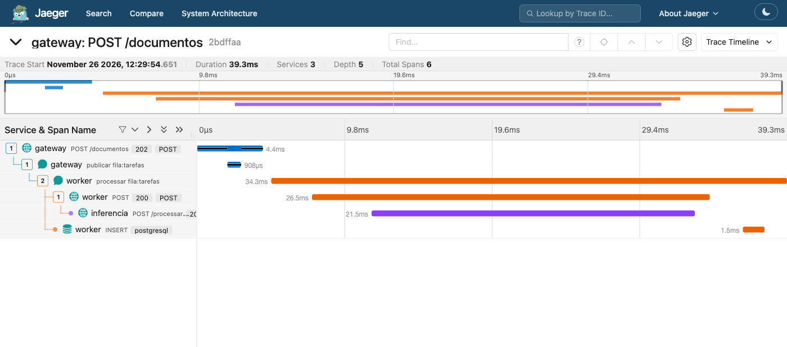
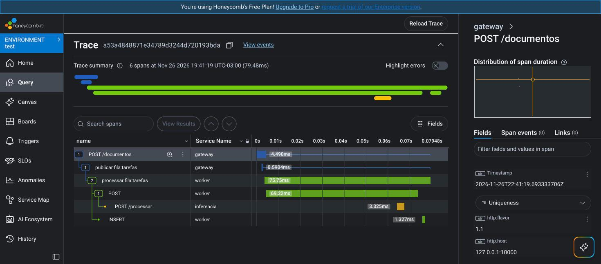

# Diário de implementação — C3.A2: Plataforma de IA como Serviço

Registro das decisões e do raciocínio, para que humanos e agentes entendam como se chegou ao
resultado. Regras de preenchimento em [CLAUDE.md](CLAUDE.md).

## Resumo

| Etapa | Status |
|-------|--------|
| Fase 0 — Ambiente | concluída e validada em 26/11/2026 |
| F1 Base da arquitetura | concluída em 26/11/2026 |
| 3 Dockerfiles e 4 Compose | concluídas em 26/11/2026 |
| 1 JWT e 2 Rate limit | concluídas em 26/11/2026 |
| 6 Resiliência | concluída em 26/11/2026 |
| 8 HTTPS | concluída em 26/11/2026 |
| 5 Deploy | concluída em 26/11/2026 |
| 7 Observabilidade no Honeycomb | confirmada em 26/11/2026 |
| 9, 10 e F2 | concluídas em 26/11/2026 |
| F3 Verificação final | falta o envio das credenciais e do link pelo usuário |

## Fase 0 — Preparação do ambiente (26/11/2026)

Objetivo: deixar o repositório e a máquina prontos para um agente novo implementar, **sem
implementar**. A preparação aconteceu no próprio dia da entrega, o que pesou a favor de
escolhas simples e de reuso.

### O que foi levantado

- Edital, ebook (blocos C2 e C3 na íntegra), arquivos do kit e os trabalhos C1.A2 e C2.A2.
- O repositório é um fork de `howardroatti/sd-2026-2-kit-c3a2` (R11), idêntico ao original
  antes desta preparação.
- Os repositórios anteriores usam um guia para agentes, tarefas em ordem, diário de
  implementação, testes por tarefa e Conventional Commits. O mesmo método foi adotado.

### Decisões do usuário

| Tema | Escolha | Alternativas descartadas |
|------|---------|--------------------------|
| Deploy | Render + Neon | VM no GCP (1 GB de RAM, possível custo de IPv4); Oracle (conta nova, risco de capacidade); Railway (crédito curto) |
| Armazenamento vetorial | pgvector | serviço próprio com o índice JSON do C2 (perde dados em disco efêmero); Qdrant (mais uma conta) |
| Rate limit | implementar | dispensar (não está no edital, mas é núcleo do kit) |
| Traces na nuvem | Honeycomb | Grafana Cloud (configuração mais longa); só Jaeger local |
| RAG com LLM do C2 | incluir, em modo simulado | só busca vetorial |
| Grupo | individual | — |
| Git | versionar `docs/` (inclusive ebook) e fazer push | — |

### Decisões técnicas da preparação

- **Edital × kit:** o edital manda. Opcionais do §8 dispensados; interface gRPC do C1 fora do
  escopo, pois a rubrica aceita "REST / gRPC / mensageria" e REST com fila já atende.
- **Um grupo de dependências por serviço** num único `pyproject.toml`, em vez de um
  `requirements.txt` por pasta ou de um workspace `uv`: um só lock e Dockerfiles que instalam
  apenas o necessário.
- **Versões:** mantidas as fixadas no kit e no C1/C2, com uma exceção: `pyjwt` subiu de
  2.9.0 para 2.15.1, porque a versão do kit tem vários avisos de segurança e é a base da
  autenticação (consulta ao OSV em 26/11/2026). Dependências novas resolvidas na versão atual
  e travadas no `uv.lock`.
- **Pendência de segurança (resolvida na continuação abaixo):** a mesma consulta aponta avisos em `starlette` 0.38.6
  (trazido pelo `fastapi` 0.115.0 do kit; alguns de severidade alta) e em `requests` 2.32.3
  (moderados). Não foram atualizados; decidir com o usuário.
- **Python 3.12**, como a imagem do kit e o C2.
- **Quatro Dockerfiles**, um para cada serviço citado no §2, inclusive o armazenamento
  vetorial. Redis e Jaeger são infraestrutura pronta e usam a imagem oficial.
- **Reuso:** módulos aproveitáveis copiados sem alteração para os serviços, para que as
  adaptações apareçam como diffs; o que serve só de modelo foi para `referencia/`.
- **Rotas, fluxo e responsabilidades** definidos em `CLAUDE.md` (raiz e diretórios), a partir
  das restrições abaixo.

### Restrições descobertas que moldaram a arquitetura

| Constatação | Consequência no plano |
|-------------|-----------------------|
| Render gratuito não tem background worker | worker é web service com consumidor em thread |
| Web service gratuito não recebe tráfego privado | chamadas por URL pública + token interno |
| Serviço dorme após 15 min | pings de despertar; falha transitória não gasta tentativa |
| Key Value gratuito não persiste | limitação a declarar no relatório CAP |
| TF-IDF do C2 muda de dimensão | `HashingVectorizer` com 512 dimensões |
| Cosseno com vetor zero no pgvector dá `NaN` (testado) | tratar texto sem tokens |
| Contexto de trace não atravessa lista Redis | injetar `traceparent` na mensagem |
| Log de acesso do uvicorn grava IP | `--no-access-log` e log próprio |
| Neon usa Postgres 18 por padrão | fixar 17, igual à imagem local |

### Verificações executadas

- `uv run pytest`: 19 passaram (dependências importáveis e modelo funcionando offline). Há um
  aviso inofensivo do scikit-learn 1.5.2 com o SciPy atual (`Unknown solver options: iprint`).
- Instalação por grupo em imagem `python:3.12-slim` arm64: gateway, inferência e worker
  construíram e importaram suas bibliotecas.
- `pgvector/pgvector:pg17` subiu, criou a extensão e calculou distância; Jaeger 2.23.0 subiu.
  Ociosos, cerca de 100 MB e 90 MB: os 2 GB do Docker devem bastar.
- Modelo e embeddings no processo local: cerca de 110 MB, abaixo dos 512 MB do Render.
- CLI do Render 2.39.0 instalado e autenticado pelo usuário durante a preparação.
- `ruff check`: 2 avisos I001 em arquivos importados, que somem na adaptação.
- **Não verificado:** compose completo, Dockerfiles finais e qualquer coisa na nuvem. Os fatos
  sobre o Render vêm da documentação, não de um deploy. Comportamentos descritos nos
  `CLAUDE.md` sobre `X-Forwarded-For`, atributos de IP nos spans e referências do
  `render.yaml` precisam ser confirmados na implementação.

### Revisão do advisor

- **Planejamento:** perguntar as decisões antes de escrever; importar o código sem alterações
  num commit próprio; registrar nos guias que o contexto de trace não atravessa a fila.
- **Revisão final, antes do push:** retirados dos guias nomes de recursos de outros projetos
  (o repositório é público); os commits de documentação, ainda locais, foram refeitos. Também
  entraram os cuidados com minutos de build do Render, tempo-limite durante o cold start da
  inferência, URLs públicas no `render.yaml` e a justificativa correta da versão do `pyjwt`.

## Fase 0 — Continuação (26/11/2026)

### Decisões do usuário

| Tema | Decisão | Motivo |
|------|---------|--------|
| Banco na nuvem | **Postgres gratuito do Render**, no lugar do Neon | a organização disponível no Neon está em plano pago por uso, e o edital exige free tier |
| Credenciais publicadas | e-mail ao professor | no README público permitiriam uso por qualquer um (leitura de textos alheios, estouro de cota); no AVA contrariariam o "APENAS o link" do §9 |
| Honeycomb | região US | — |
| Vulnerabilidades | atualizar | — |

Consequências do novo banco: sem conta extra e com acesso por rede privada; em troca, expira
em 30 dias, não tem backup e há um só por workspace. Por isso é criado apenas no deploy. Onde
a seção anterior menciona o Neon, vale esta decisão.

### O que foi feito

- `fastapi` 0.115.0 → 0.165.0 (leva o `starlette` a 1.10.0) e `requests` 2.32.3 → 2.34.2;
  `pydantic` e `uvicorn` não precisaram mudar. Depois disso: 19 testes passando, builds por
  grupo em Docker ok e consulta ao OSV sem avisos nos 65 pacotes travados.
- Teste rápido da instrumentação com as novas versões: `/saude` excluído dos traces; spans
  trazem `net.peer.ip`, que precisa ser removido (LGPD).
- Pyright instalado com `vp` (ferramenta Node) e apontado para o `.venv`. Os erros que acusa
  estão nos arquivos importados.
- CLI do Render: workspace definido; nenhum serviço criado.
- Blueprint rascunhado em `deploy/render.yaml.rascunho` e aprovado por
  `render blueprints validate` (6 recursos); um plano inválido foi recusado, o que mostra que a
  validação verifica de fato. Comportamento em execução não verificado.
- A conexão do GitHub ao Render exige consentimento no navegador e ficou com o usuário.

### Revisão do advisor (continuação)

- Edições nos guias disparariam builds: o `buildFilter` passou a ignorar `**/*.md`.
- O usuário de demonstração estava fixo no rascunho do Blueprint, num repositório público:
  passou a ser preenchido no painel (`sync: false`).

## Fase 0 — Validação de prontidão (26/11/2026)

- **Decisões do usuário:** a chave do Honeycomb será criada só quando houver onde preenchê-la
  no Render (Tarefa 5); `git push` autorizado ao fim de cada tarefa, mantida a confirmação
  antes do primeiro deploy.
- O usuário informou ter instalado o app do Render no repositório e adicionado a credencial do
  GitHub. Não há como confirmar sem criar o Blueprint.
- Plugin `render-visual-skill` (diagramas, sem relação com o Render.com) removido; fica o
  oficial `render@claude-plugins-official`, com o MCP ainda sem autenticação.
- **Clone limpo do GitHub:** `uv sync` ok; 19 testes passando; `ruff` (2 avisos) e `pyright`
  (12 erros) só em arquivos importados; rascunho do Blueprint válido; `docker compose config`
  aceita o compose do kit, que ainda não funciona; nenhum link relativo quebrado; âncoras do
  ebook corretas.
- **Máquina:** `uv`, `gh`, `render` e Docker operando, imagens base presentes. A porta 5432 está
  ocupada por um Postgres do usuário, e os guias passaram a proibir o uso dela.
- Acrescentados aos guias três riscos vistos na releitura: `psycopg` ausente na imagem do
  gateway, `register_vector` antes de existir a extensão e tempo-limite longo somado a
  retentativas.

## Decisões do usuário no início da implementação (26/11/2026)

| Tema | Decisão | Motivo |
|------|---------|--------|
| Ordem | deploy (5 e 8) depois de F1, 3, 4, 1, 2, 6 e 7 | uma só parada do usuário; gateway nunca público sem JWT; menos minutos de build. Risco aceito: surpresas do deploy aparecem mais tarde |
| Blueprint | criado pelo usuário no painel | os segredos são digitados só ali |
| Credenciais publicadas | arquivo local fora do repositório, permissão 600 | os scripts de aceite leem sem exibir |
| Autorizações | Docker deste projeto; operar os recursos `c3a2-*` depois de criados; Chrome para conferir painel e traces | — |

## F1 — Base da arquitetura (26/11/2026)

**O que foi feito:** `comum/` (contrato da fila, validação de entrada, log e erros, token
interno, propagação de contexto), `vetorial/` (esquema e repositório), serviço de inferência,
worker e roteamento no gateway, cada parte com testes e commit próprio.

**Decisões e justificativas:**

- **Contrato em `comum/contrato.py`**, para gateway e worker concordarem sem um importar o
  outro; o lado consumidor ficou em `worker/fila.py`.
- **Mesma validação nos dois lados** (`comum/modelos.py`): entrada inválida morre no gateway e
  nunca conta como falha de dependência (Aula 11).
- **Vetor enviado como texto com `::vector`**, em vez de `register_vector`: funciona mesmo
  antes de a extensão existir, eliminando a corrida entre inferência e worker na subida. A
  dependência `pgvector` do Python deixou de ser usada.
- **Fila confiável com saída atômica:** a mensagem só sai de `processando` na mesma transação
  que conclui, reenfileira ou descarta. No C2 o `lrem` num `finally` podia perder a mensagem
  se o reenfileiramento falhasse.
- **Falha transitória não gasta tentativa** (Aulas 8 e 11): espera progressiva e, só depois de
  `TAREFA_IDADE_MAXIMA`, dead-letter. Permanente: `MAX_TENTATIVAS`.
- **Retenção (Aula 16):** expurgo na subida e periódico; fila, dead-letter e estado da tarefa
  têm prazo no Redis; o motivo do descarte é só o tipo do erro.
- **`com_retentativa` ganhou `prazo_total`**, para tempo-limite longo não se multiplicar.
- **Inferência e worker sem `/docs`**, e tudo que não é `/saude` exige o token (Zero Trust).
- Os `README.md` de espera de `inferencia/` e `worker/` saíram agora, não na F3.

**Verificação:** `uv run pytest` com 131 testes passando, sem rede, Docker ou chave;
`ruff check` e `pyright` sem apontamentos. **Ainda não verificado contra serviços reais:** o
SQL só rodou com o pool substituído; o compose (Tarefas 3 e 4) é a primeira prova.

**Revisão do advisor:** sem bloqueios; pediu o `.env.example` completo (15 variáveis
faltavam) e a prova de ponta a ponta no banco real junto com o compose.

## Tarefas 3 e 4 — Dockerfiles e compose (26/11/2026)

**O que foi feito:** um Dockerfile por serviço (os quatro do §2, inclusive o vetorial),
`.dockerignore`, `docker-compose.yml` com healthchecks e o teste ponta a ponta.

**Decisões e justificativas (Aulas 13 e 14):**

- Dependências instaladas com `uv sync --frozen --only-group <servico>`, antes do código, para
  a camada ser reaproveitada; apps rodam com usuário sem privilégios.
- O modelo é treinado no build da inferência: o usuário da imagem não grava na pasta e o cold
  start fica menor.
- Só `8000` e `16686` publicadas. Os endereços entre serviços são fixos no compose (descoberta
  por nome), o que também impede que uma variável do shell aponte o sistema local para um banco
  alheio.
- **Jaeger sem healthcheck** (desvio do texto da tarefa): a imagem não tem shell nem comando de
  verificação, e nenhum serviço depende dele para subir.
- Fila local com `appendonly`, para sobreviver a reinícios; na nuvem o Key Value não persiste.
- As verificações de saúde passaram a ser registradas só em depuração, para não afogar os logs.

**Problemas encontrados:** um `git add` com arquivos já removidos interrompeu a sequência de
commits; o primeiro clone limpo falhou por isso. Como efeito, a remoção de
`gateway/requirements.txt` e `Dockerfile.exemplo` ficou no commit "registra as verificações de
saúde só em depuração". O histórico não foi reescrito.

**Verificação:** `docker compose build` sem erros; `id -u` = 1000 nos três apps;
`modelo.joblib` presente na imagem. Num **clone limpo, sem `.env` e com volumes vazios**,
`docker compose up --build -d --wait` subiu tudo e `uv run pytest -m e2e` passou (6 testes),
exercitando o SQL no Postgres real (esquema, inserção com `::vector`, busca com `<=>`).
Memória em repouso: inferência 112 MB, worker 60 MB, vetorial 57 MB, gateway 55 MB, Jaeger
16 MB, Redis 5 MB — folga grande para os 512 MB por serviço do Render.

**Revisão do advisor:** sem bloqueios; pediu o registro do commit misturado, do Jaeger sem
healthcheck e das medidas de memória.

## Tarefas 1 e 2 — JWT e rate limit (26/11/2026)

**O que foi feito:** `POST /login` com JWT HS256 e expiração; rotas de negócio num roteador
que exige token e conta no limite; rate limit de janela fixa no Redis.

**Decisões e justificativas (Aulas 8 e 16):**

- **Falha fechada:** segredo com menos de 32 bytes impede a subida; sem `USUARIO_DEMO` ou
  `SENHA_DEMO` todo login é recusado. Assim um deploy ainda sem as variáveis não fica aberto.
- Proteção por roteador, não rota a rota, para não existir rota de negócio esquecida.
- 401 montado pela aplicação (`auto_error=False`), com `WWW-Authenticate: Bearer`.
- Chave do limite é um **HMAC** com o segredo, tanto para o usuário quanto para o IP, com TTL
  de 60 s: um hash simples de IPv4 seria revertido por força bruta. É pseudonimização, não
  anonimização, e entra na tabela da LGPD.
- Redis fora do ar libera a requisição (disponibilidade), com aviso no log.
- **IP atrás de proxy — não confirmado.** Não há documentação oficial do Render para web
  services. Um [artigo do Render sobre proxy](https://render.com/articles/how-to-proxy-analytics-through-your-own-domain),
  testado num site estático, mostra o IP também em `CF-Connecting-IP` e `True-Client-IP`, e
  não diz se o cliente consegue forjá-los. Por isso a origem é configurável
  (`CABECALHO_IP_CLIENTE` ou `PROXIES_CONFIAVEIS`, lido da direita) e o padrão é o endereço da
  conexão: na nuvem o login provavelmente cai numa cota única, mas não pode ser burlado.

**Verificação:** 172 testes unitários; no compose, e2e com login passando, rotas sem token 401,
inferência e worker 401 sem o token interno, 70 logins com `X-Forwarded-For` forjado
estourando o limite (429 com `Retry-After`) e chaves no Redis contendo só HMAC.

**Revisão do advisor:** sem bloqueios; pediu o registro do IP como não confirmado e apontou
para a Tarefa 6 que `prazo_total` ainda não limitava a duração de cada tentativa.

## Tarefa 6 — Resiliência (26/11/2026)

**O que foi feito:** tempo-limite, retentativa e disjuntor nas chamadas gateway→inferência,
worker→inferência e inferência→LLM; estado dos disjuntores nas rotas `/saude`.

**Decisões e justificativas (Aula 11):**

- Composição `disjuntor(retentativa(tentativa com tempo-limite))`: uma sequência esgotada
  conta como **uma** falha.
- `prazo_total` passou a limitar também a **duração** de cada tentativa: antes, com
  tempo-limite de 90 s na nuvem, a sequência poderia chegar a 180 s.
- **O que conta como falha:** erro de transporte, 5xx e 429. Um 4xx volta como resposta. No
  gateway, o 503 **degradado** da inferência (banco ou LLM fora) também não conta: senão uma
  queda do banco derrubaria o `/predict`, que não depende dele.
- Orçamentos aninhados: busca no banco (`DB_TIMEOUT`, 5 s) mais o prazo do LLM
  (`LLM_PRAZO_TOTAL`, 4 s) ficam abaixo do tempo-limite do gateway (10 s).
- `llm.gerar` ganhou o parâmetro opcional `tempo_limite` (única mudança no cliente do kit).
- No worker, circuito aberto é falha transitória e a espera é a que o disjuntor pede.
- Sem disjuntor no banco: o pool já limita cada tentativa a `DB_TIMEOUT` (5 s).

**Verificação no sistema rodando:**

| Falha provocada | Observado |
|-----------------|-----------|
| `docker compose stop inferencia` | `/predict` 503 em cerca de 1,9 s nas três primeiras e em 6 ms com o circuito aberto; `/saude` mostra `aberto`; volta a 200 ao religar |
| documento enviado durante a queda | 202; tarefa `pendente` com 0 tentativas, dead-letter intacta; concluída após religar |
| `docker compose stop vetorial` | `/buscar` 503 degradado em 5 s; `/predict` segue 200 e o circuito do gateway fica fechado; busca volta sozinha ao religar |
| LLM inacessível (`LLM_API_URL` inválida) | `/perguntar` 503 com trechos e fontes em cerca de 2 s e, com o circuito aberto, em 20 ms; `/predict` não é afetado |

O teste `test_inferencia_fora_do_ar_degrada_e_depois_se_recupera` repete o primeiro cenário
(e2e: 12 passando). Unitários: 185 passando.

**Revisão do advisor:** sem bloqueios; apontou que o orçamento aninhado ignorava o tempo da
busca no banco. O prazo do LLM caiu de 8 s para 4 s e há um teste para a soma.

## Tarefa 7 — Observabilidade (26/11/2026)

**O que foi feito:** OpenTelemetry nos três serviços (HTTP recebido e feito, Postgres), spans
`publicar fila:tarefas` e `processar fila:tarefas` com o contexto viajando na mensagem,
`trace_id` em todas as linhas de log e limpeza dos spans antes da exportação.

**Decisões e justificativas (Aula 15):**

- Só há exportação com `OTEL_EXPORTER_OTLP_ENDPOINT` preenchido; sem ele os ids continuam
  correlacionando os logs.
- A limpeza fica num **exportador que envolve o OTLP**, porque os atributos são somente leitura
  depois de o span encerrar. Saem IP, porta, agente do usuário, caminho e consulta digitados
  pelo cliente (fica `http.route`), mensagens e pilhas de exceção e descrições de erro. Os
  testes usam o mesmo invólucro sobre um exportador em memória.
- O span do consumidor só é aberto depois que o `BLMOVE` entrega uma mensagem: o laço ocioso
  não gera traces.
- A consulta vazia com que o pool testa a conexão é descartada: virava um span sem informação.
- `trace_id` entra por uma fábrica de registros de log, valendo para qualquer linha.

**Problemas encontrados:** o Jaeger 2.23 não responde na API antiga (`/api/traces`); o teste
usa a `/api/v3`.

**Verificação:** 197 testes unitários e 13 e2e passando. O teste e2e consulta o Jaeger e exige
um único `traceId` com `POST /documentos` (gateway) → `publicar` → `processar` (worker) →
`POST /processar` (inferência) → `INSERT` (Postgres). Num trace gerado durante a queda da
inferência aparecem também as tentativas e adiamentos. Nos logs dos três serviços não há
texto, senha, token, usuário nem IP.

**Revisão do advisor:** sem bloqueios; manter a tarefa aberta até conferir o Honeycomb.

## Tarefa 5 — Preparação do deploy (26/11/2026)

- `render.yaml` na raiz, a partir do rascunho, com os tempos-limite da nuvem num grupo de
  variáveis; os únicos campos preenchidos no painel são `USUARIO_DEMO`, `SENHA_DEMO` e os três
  `OTEL_EXPORTER_OTLP_HEADERS`. `render blueprints validate`: válido, 7 recursos.
- Credenciais geradas em `~/.config/c3a2/credenciais.env` (fora do repositório, permissão 600),
  sem exibição.

## Tarefas 5 e 8 — Primeiro deploy (26/11/2026)

**O que foi feito:** o usuário aplicou o Blueprint no painel.

**Problema encontrado:** a sincronização criou banco, fila e grupos, publicou a inferência em
pouco mais de um minuto e ficou mais de 30 minutos presa nessa etapa, sem criar worker e
gateway, sem erro e sem incidente na página de status do Render. A diferença entre essa etapa e
as demais era que worker e gateway liam a `RENDER_EXTERNAL_URL` da inferência por
`fromService … envVarKey`; a documentação do Blueprint só descreve o uso das variáveis padrão
pelo próprio serviço. Com as URLs públicas fixas no `render.yaml`, o push abriu uma nova
sincronização e os dois serviços foram criados em segundos. A causa é a explicação mais
provável do que se observou, não algo confirmado pelo Render. O `render blueprints validate`
aceitava a versão anterior.

**Decisões:** URLs fixas no arquivo (não são segredo). Alternativa descartada: variáveis
`sync: false` digitadas no painel, que acrescentariam um passo manual. Custo: numa instalação
nova é preciso ajustar as URLs (ver `deploy/INSTRUCOES.md`).

**Verificação:** os três serviços no ar; log do worker com a linha de expurgo (banco, esquema e
fila). `http://` responde 301 para `https://` nos três; certificado válido (Google Trust
Services). Sem o token interno, inferência e worker respondem 401, inclusive em `/docs`.

**Pendências:** nos primeiros testes o login publicado respondeu 401 com as credenciais do
arquivo local, e o exportador de traces recebeu 401 do Honeycomb nos três serviços. Ambos
dependem de valores que só o usuário digita no painel.

**Revisão do advisor:** identificou a referência entre serviços como causa provável do
travamento; depois, pediu para publicar a documentação já e concluir a Tarefa 8.

## Tarefas 5 e 7 — Variáveis do painel e verificação (26/11/2026)

**Problema encontrado:** `USUARIO_DEMO`, `SENHA_DEMO` e `OTEL_EXPORTER_OTLP_HEADERS` não
existiam nos serviços, embora tivessem sido preenchidos na tela do Blueprint. Isso explica os
dois 401 (login e Honeycomb). A relação com a sincronização travada é uma hipótese, não
verificada. O usuário criou as variáveis em cada serviço. O gateway se comportou como
projetado: sem credenciais configuradas, recusou todo login.

**Verificação no ambiente publicado:**

- `uv run pytest -m e2e` com `URL_BASE`: 11 passaram e 2 foram pulados (exigem o compose).
- Nenhum erro de exportação nos logs depois do novo deploy.
- Logs de execução dos três serviços (cerca de 750 linhas, comparação automática sem exibir
  valores): sem usuário, senha, textos enviados, pergunta, token, chave ou IP.
- Honeycomb: um único trace com 6 spans, `POST /documentos` → `publicar` → `processar` →
  `POST /processar` → `INSERT`. O `db.statement` traz os marcadores `%s`; o span do gateway não
  tem IP do cliente nem agente do usuário. Um primeiro trace aparecia sem a raiz porque o
  cliente dos testes, instrumentado no mesmo processo, enviava o próprio `traceparent`; um envio
  por cliente sem instrumentação mostrou o trace completo.

## Tarefa 5 — Cold start no ambiente publicado (26/11/2026)

**Problema encontrado:** medição feita depois de os três serviços registrarem o desligamento
(22:56 e 22:59 UTC), com acesso externo só ao gateway:

- o gateway acordou em cerca de 18 s;
- inferência e worker não registraram nenhuma linha por mais de 15 minutos, apesar dos pings de
  despertar e das chamadas do gateway;
- cada tentativa do gateway voltava com erro em cerca de 1 s, e o `/predict` respondeu 503 por
  mais de 5 minutos;
- um `curl` externo ao `/saude` acordou o worker em 17,6 s e a inferência em 27,6 s;
- enquanto acordados, as chamadas internas os mantiveram ativos (a inferência desligou
  exatamente 15 minutos após a última chamada do worker).

O código de status devolvido nas tentativas não foi registrado. Relatos de outros projetos
descrevem um 429 da borda do Render para serviços adormecidos
([exemplo](https://github.com/edmullen/credentials-demo/pull/47)); não confirmado aqui.

**Decisão:** `GET /` no ambiente publicado passa a servir uma página que abre o `/saude` da
inferência e do worker em quadros, no navegador do visitante, e leva ao `/docs` em 45 s. Sem
endereço `https` (compose local), continua o redirecionamento. É um desvio do contrato
planejado para a rota. O README documenta também o caminho por `curl`.

**Alternativas descartadas:** disfarçar o agente do usuário ou os cabeçalhos das chamadas entre
serviços (seria contornar a proteção do provedor); ping externo periódico (exige outra conta e
três serviços sempre ligados esgotariam as 750 h mensais em cerca de 10 dias).

**Latências publicadas:** em [trade-offs](trade-offs.md#publicado).

**Verificação da correção:** deploy só do gateway; os três registraram desligamento
(23:43 UTC). Abrir a URL num navegador automatizado (Playwright) às 23:44:49 mostrou a tela de
carregamento do Render e depois a página; gateway, worker e inferência registraram subida às
23:45:02, 23:45:20 e 23:45:31; a página levou ao `/docs`. Em seguida,
`medir_latencia.py --primeiro-uso` fez o fluxo completo em 1,5 s sem 503 e o e2e publicado
passou (11, 2 pulados). Não foi observado o conteúdo final dos quadros da página.

**Verificação final local, com o mesmo código:** 200 unitários, 13 e2e no compose, `ruff` sem
apontamentos, nenhum dado pessoal nos logs. Antes da correção, um clone limpo do GitHub, sem
`.env` e construído sem cache, subiu com um comando e passou nos mesmos testes.

**Revisão do advisor:** apontou que o despertar só pode partir do cliente, que o ajuste antes
sugerido (`URL_WORKER`) não acordaria o worker, e propôs a página no gateway.

## F3 — Verificação final (26/11/2026)

- Clone limpo do GitHub (commit `e0ac1d2`), sem `.env`, construído sem cache e no ar em 41 s com
  um comando: 200 unitários, `ruff` limpo, 13 e2e e os exemplos do README.
- Busca no histórico: sem o usuário, a senha publicados ou chave do Honeycomb.
- `referencia/` removida. Os excludes dela no `pyproject.toml` ficaram, porque alterar esse
  arquivo republicaria os três serviços.
- Falta ao usuário: enviar as credenciais ao professor por e-mail e postar no AVA somente o link
  do repositório.

**Revisão do advisor (final):** sem bloqueios; a correção do cold start está verificada e não há
mudança de código depois dela. Pediu o aviso no README sobre tarefa que fica `pendente`.

<!--
Modelo para as próximas etapas:

## Tarefa N — Título (data)

**O que foi feito:**
**Decisões e justificativas:** (alternativas descartadas; ligação com as aulas)
**Problemas encontrados:**
**Verificação:** (comandos e resultado real)
**Revisão do advisor:** (apontamentos e ajustes)
**Desvios do plano / pendências:**
-->
